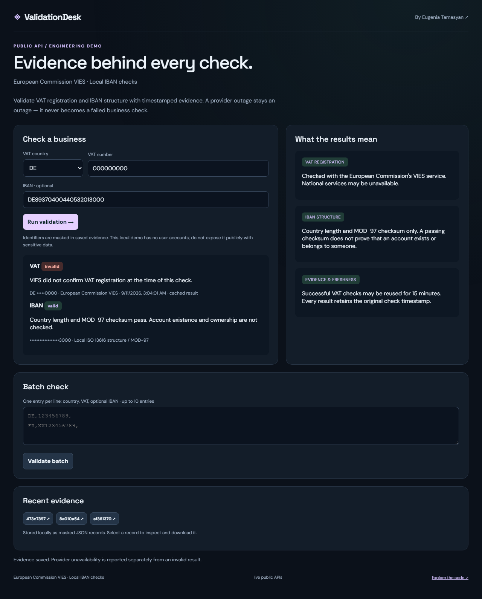
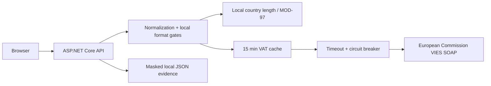

# ValidationDesk

[](https://github.com/itinessity/validation-desk/actions/workflows/ci.yml)


An explainable VAT and IBAN validation workflow. Every result states what was checked, by which source and when — including when a provider cannot answer.

**[Eugenia Tamasyan](https://itinessity.com)** · Senior .NET Backend Engineer · FinTech & Distributed Systems



## What you can try

- VAT registration checks through the European Commission VIES SOAP service.
- Distinct `valid`, `invalid`, `invalid_input`, `provider_unavailable` and `not_checked` outcomes.
- Local IBAN country-length and MOD-97 checks for the countries listed in `src/Iban.cs`.
- A 20-second provider timeout, serialized provider access, 15-minute positive/negative result cache and a 30-second circuit break after three provider failures.
- Batches of up to ten entries, masked saved evidence and JSON downloads.
- XML parsing with DTDs prohibited, no external XML resolver and a bounded document size.

## Run locally

Requires the **.NET 10 SDK**. No provider account or API key is needed. Internet access is required for live data.

```bash
dotnet run --project src/App.csproj -c Release
```

Open **http://127.0.0.1:8080**. The application binds to loopback by default. To run several demos simultaneously, set a different `ASPNETCORE_URLS` per process. Each repository is independent.

Or use Docker:

```bash
docker compose up --build
```

The container also exposes only local port 8080 through Compose. It runs as the .NET image's non-root `app` user. Stop it with `docker compose down`; the named data volume persists.

Saved JSON lives under `DATA_DIR` (default `.data` relative to the process working directory). Writes use a temporary file and atomic rename in a single process. The store caps records at 200 and lists the 30 most recent in the UI. Export and remove old local records when capacity is reached. Do not share this directory between multiple application processes.

## Walkthrough

1. Enter a supported VIES country and a VAT number you are authorized to check; add an optional IBAN.
2. Run validation. The VAT registration result and local IBAN result are shown separately.
3. Open saved evidence to inspect the original check timestamp and download masked JSON.
4. Use the batch panel for up to ten comma-separated entries. It processes the entries sequentially.

## Architecture



The backend uses ASP.NET Core minimal APIs and built-in .NET libraries. The browser uses plain JavaScript and CSS; Node.js is needed only for browser tests. Provider/domain logic is separated from the HTTP endpoints in `src/`. The common infrastructure is intentionally small enough to inspect.

## API

| Endpoint | Behavior |
|---|---|
| `POST /api/validate` | `{ "country": "DE", "vat": "...", "iban": "..." }` |
| `POST /api/batch` | Array of 1–10 validation inputs |
| `GET /api/audit` | Up to 30 recent local evidence IDs |
| `GET /api/audit/{id}` | Original masked evidence record |
| `GET /api/health` | Process status and an explicit live/fixture mode label |

The API accepts JSON request bodies and returns structured errors. Bodies are limited to 64 KB. Browser writes with a foreign Origin are rejected. The health endpoint reports process availability, not guaranteed provider availability.

## Verify

```bash
dotnet build src/App.csproj -c Release
dotnet run --project tests/Tests.csproj -c Release
python tests/integration.py
npm ci
npx playwright install chromium
npm run test:browser
```

Known IBAN checksum vectors, unsupported/malformed identifiers, SOAP faults, forbidden DTD/XXE, original cache timestamps, masked persistence, batch limits and browser-visible provider outages.

The C# checks are dependency-free executable assertions. HTTP tests launch an isolated process with a temporary data directory. Playwright covers the primary user flow and mobile overflow. CI runs all three layers on Ubuntu, builds a Release publish output and uses deterministic fixtures, so it does not depend on public-provider uptime.

Fixtures require **both** `ASPNETCORE_ENVIRONMENT=Testing` and `TestFixtures=true`. The UI labels fixture mode. Real-provider outages are never replaced by fixture data. Local live-provider and visual smoke checks are documented in [verification notes](docs/VERIFICATION.md).

## Boundaries and trade-offs

A passing IBAN checksum does not prove account existence or ownership. VAT registration is not identity verification. The local VAT gate performs basic character/length checks (and the German nine-digit rule); VIES remains responsible for country-specific validity.

Spaces, periods and hyphens are removed during normalization; Greek `GR` is mapped to the VIES prefix `EL`. Only countries explicitly listed in `Validator.cs` are accepted for VAT checks, and `Iban.cs` defines the supported IBAN lengths.

Outages are not cached as invalid results. Cached answers keep the original `checkedAt` timestamp. A timeout is not automatically retried; the user may retry after recovery. The circuit breaker and cache are in memory and reset on restart. The cache is cleared at 500 entries. Batch writes are sequential and can leave partial evidence if storage reaches capacity.

Evidence retains masked identifiers only. The in-memory VAT cache necessarily holds normalized identifiers for its short lifetime. Request bodies are not logged by the application. This local demo has no authentication and shares its evidence store with everyone who can reach the instance.

This is a runnable local reference implementation, not a publicly hosted production service. Before deploying it for shared use, address the controls listed in [SECURITY.md](SECURITY.md). Original code is MIT-licensed; external data and vendored assets retain their own terms.

## Data sources

- [VIES technical information](https://ec.europa.eu/taxation_customs/vies/#/technical-information)
- [Official VIES WSDL](https://ec.europa.eu/taxation_customs/vies/checkVatService.wsdl)
- [SWIFT IBAN registry](https://www.swift.com/standards/data-standards/iban-international-bank-account-number)

## About the author

I build .NET backends, trading integrations and reliable data workflows. See [itinessity.com](https://itinessity.com) for commercial experience and ways to work together.
